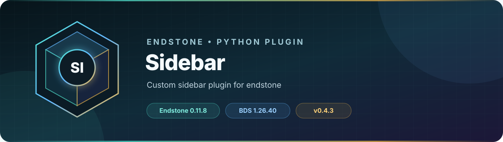

<!-- endstone-professional-header:start -->
<p align="center">
  
</p>

<p align="center">
  <a href="https://github.com/TheNINJALLO/endstone-sidebar/actions/workflows/wheel-release.yml"></a>
  <a href="https://github.com/TheNINJALLO/endstone-sidebar/releases/latest"></a>
</p>

<p align="center">
  
  
  
  =3.10" src="https://img.shields.io/badge/Python-%3E=3.10-3776AB?style=flat-square&amp;logo=python&amp;logoColor=white">
</p>

<p align="center">
  <strong>Custom sidebar plugin for endstone.</strong>
</p>

<p align="center">
  <a href="#overview">Overview</a> &bull;
  <a href="#compatibility">Compatibility</a> &bull;
  <a href="#install">Install</a> &bull;
  <a href="https://github.com/TheNINJALLO/endstone-sidebar/releases">Releases</a>
</p>

## Overview

Custom sidebar plugin for endstone. This release is aligned with Endstone 0.11.8 and Minecraft Bedrock Dedicated Server 1.26.40, and is distributed as a Python wheel for direct installation in an Endstone server.

## Capabilities

-

## Compatibility

| Component | Supported version |
|---|---|
| Endstone | `0.11.8` |
| Endstone API | `0.11` |
| Bedrock Dedicated Server | `1.26.40` |
| Python | `>=3.10` |
| Plugin release | `v0.4.3` |

## Install

Download the wheel from the matching GitHub release:

```bash
gh release download v0.4.3 --repo TheNINJALLO/endstone-sidebar --pattern "*.whl"
```

Copy the downloaded wheel into the server's `plugins/` directory, remove any older wheel for the same plugin, and restart Endstone.

> [!IMPORTANT]
> Use Endstone `0.11.8` with BDS `1.26.40`. Back up worlds and plugin data before upgrading a production server.

## Configuration and secrets

Runtime databases, logs, local `.env` files, server directories, and root `config.toml` files are excluded from source releases. When an example configuration is provided, copy it locally and keep live tokens, passwords, webhook URLs, and server identifiers out of Git.

## Release automation

Every `v*` tag runs [the wheel release workflow](.github/workflows/wheel-release.yml), builds the package in a clean GitHub runner, stores the wheel as a workflow artifact, and attaches it to the matching GitHub release.
<!-- endstone-professional-header:end -->

---

## Project guide

Custom sidebar plugin for endstone server.

## Supported Variables

- [x] `{x}` x coordinate
- [x] `{y}` y coordinate
- [x] `{z}` z coordinate
- [x] `{player_name}` player's name
- [x] `{dimension}` dimension name
- [x] `{dimension_id}` dimension id
- [x] `{ping}` player ping
- [x] `{date}` date
- [x] `{time}` time
- [x] `{datetime}` date and time
- [x] `{year}` year
- [x] `{month}` month
- [x] `{day}` day
- [x] `{hour}` hour
- [x] `{minute}` minute
- [x] `{second}` second
- [x] `{mc_version}` minecraft version
- [x] `{online}` online player count
- [x] `{max_online}` max online player count
- [x] `{address}` player's address
- [x] `{runtime_id}` player's runtime id
- [x] `{exp_level}` player's experience level
- [x] `{total_exp}` player's experience in total
- [x] `{exp_progress}` player's experience progress
- [x] `{game_mode}` player's game mode
- [x] `{xuid}` player's xuid
- [x] `{uuid}` player's uuid
- [x] `{device_os}` os name of player's current device
- [x] `{locale}` player's locale

## Install

- Download .whl file from [release](https://github.com/endstone-essentials/sidebar/releases) or [action](https://github.com/endstone-essentials/sidebar/actions/workflows/build.yml)
- Put it into `plugins` folder
- Restart the server, enjoy!

## Requirement

Python: 3.10+

Endstone: 0.5+
